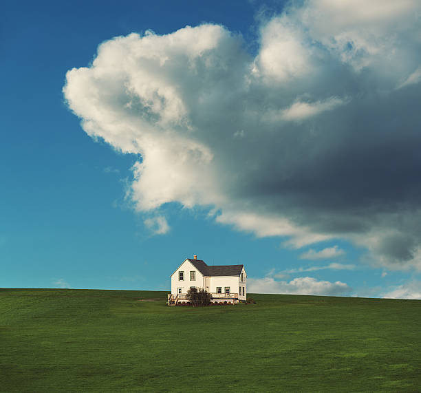
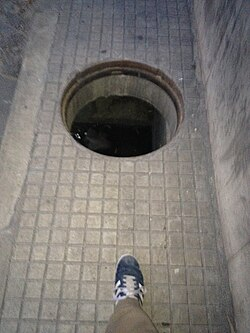

# VLM Tests

Simple VLM tests to check the reasoning and performance of the models in question

## Qwen 3

This is a close-up photograph of a very young, light-colored puppy, likely a golden retriever or a similar breed, looking directly at the camera with wide, dark eyes. The puppy has a soft, fluffy coat and a black nose. It is positioned in the foreground, with a white plastic chair visible to its left and a blurry, natural landscape of hills or mountains in the background. The lighting appears to be from the sun, possibly at sunrise or sunset, casting a warm, golden glow on the scene.

This image captures a serene and striking rural landscape, dominated by a single white house set upon a vast, rolling green hill.

The composition is defined by its strong contrast between the earthy tones of the landscape and the expansive sky. The house, a simple two-story structure with a dark, possibly slate, roof and white walls, stands as a solitary focal point. It is positioned on the crest of the hill, which is covered in lush, vibrant green grass that stretches out to the horizon. The house is surrounded by a small, wooden deck or porch area.

Above, the sky is a brilliant blue, but it is dramatically altered by 

*(it was most likely cut of by limit of words reached, which can be expanded)

This is a low-angle, ground-level photograph taken at night, showing a person's foot in a blue and white sneaker walking on a tiled pavement. The person is positioned in the lower center of the frame, and the perspective looks up toward a large, circular manhole cover. The manhole is set into a concrete structure, and the dark, murky interior of the manhole is visible. The pavement is made of light-colored, square tiles, and the surrounding walls are concrete. The image has a dark, gritty feel, with the lighting focused on the manhole and the foot, creating a sense of depth and perspective.

